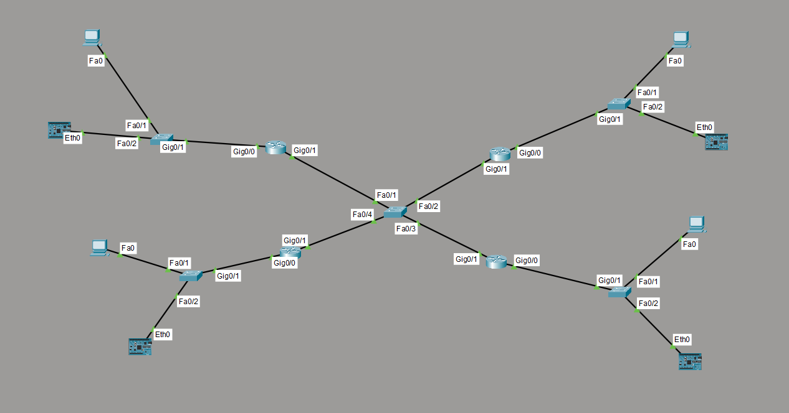
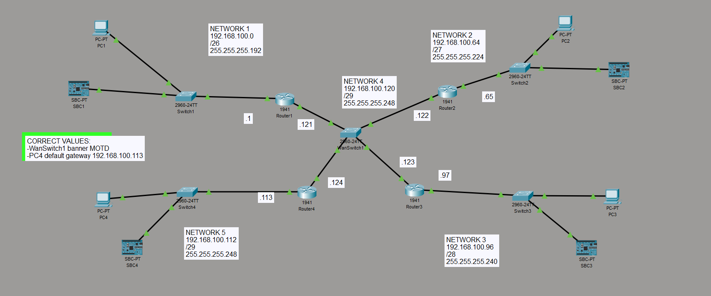

# Network Topology Configuration

This project contains the configuration and topology setup created in Cisco Packet Tracer.  
The network includes:

- Switch1 for LAN switching
- Router2 for routing between LAN and WAN
- End devices connected through FastEthernet interfaces

---

# Device Configuration Summary

## Switch1

### General Settings
- Hostname: `Switch1`
- IOS Version: `15.0`
- Password encryption enabled
- Spanning Tree Protocol: `PVST`
- MOTD banner configured

### Interface Configuration
| Interface | Description | Status |
|-----------|-------------|--------|
| Fa0/1 | PC | Active |
| Fa0/2 | SBC | Active |
| Fa0/3 - Fa0/24 | Unused | Shutdown |
| Gi0/1 | Router | Active |
| Gi0/2 | Unused | Shutdown |

### Management Configuration
- VLAN1 IP Address: `192.168.100.2/26`
- Default Gateway: `192.168.100.1`

---

## Router2

### General Settings
- Hostname: `Router2`
- IOS Version: `15.1`
- Password encryption enabled
- IP CEF enabled
- MOTD banner configured

### Interface Configuration
| Interface | Description | IP Address |
|-----------|-------------|------------|
| Gi0/0 | LAN | `192.168.100.65/27` |
| Gi0/1 | WAN | `192.168.100.122/29` |
| VLAN1 | Unused | Shutdown |

### Routing Features
- IP routing enabled
- IP classless enabled
- NetFlow export version 9 configured

# Packet Tracer Workspace Snapshot

Below is the topology workspace used in Packet Tracer.

# Notes

- All unused ports are administratively shut down for security purposes.
- Console and VTY access are password protected.
- Device configurations were verified using `show running-config`.