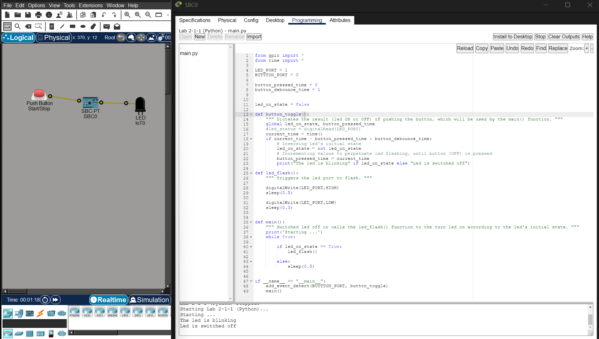

# Button-Controlled LED Blinking System (Python)

This project is a Python GPIO control script that uses a push button to toggle an LED blinking sequence ON and OFF.

The system uses event detection and software debouncing to ensure reliable button input handling.

---

# Features
- Push button toggles LED blinking state
- LED flashes continuously when activated
- Event-driven button detection
- Software debounce protection -> to prevent multiple unintended button triggers.
- Continuous execution loop

---

# Technologies Used
- Python
- GPIO Library

---

# Components and Port Assignment

| Component | GPIO Port |
|-----------|------------|
| Push Button | `0` |
| LED | `1` |


# Script Behaviour

## Button Pressed
When the push button is pressed:

- The LED blinking state is toggled
- If OFF → LED blinking starts
- If ON → LED blinking stops

Console messages:
```
The led is blinking
```
or
```
Led is switched off
```

# Packet Tracer Workspace Snapshot
Below is the topology workspace used in Packet Tracer.



# Demo
Below is the project demo of the blinking system using push button.

<video src="../media/lab-2.1.1-demo.mp4" controls></video>

## Notes
- The script uses add_event_detect() for event-driven button handling.
- LED blinking continues until the button is pressed again.
- Timing control is managed using Python's sleep() function.
- The program runs continuously until manually terminated.