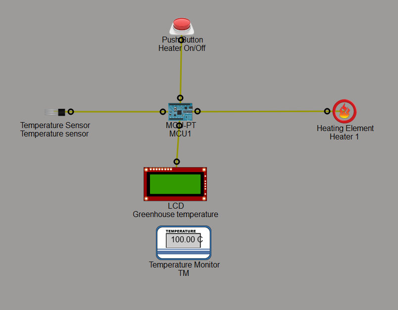
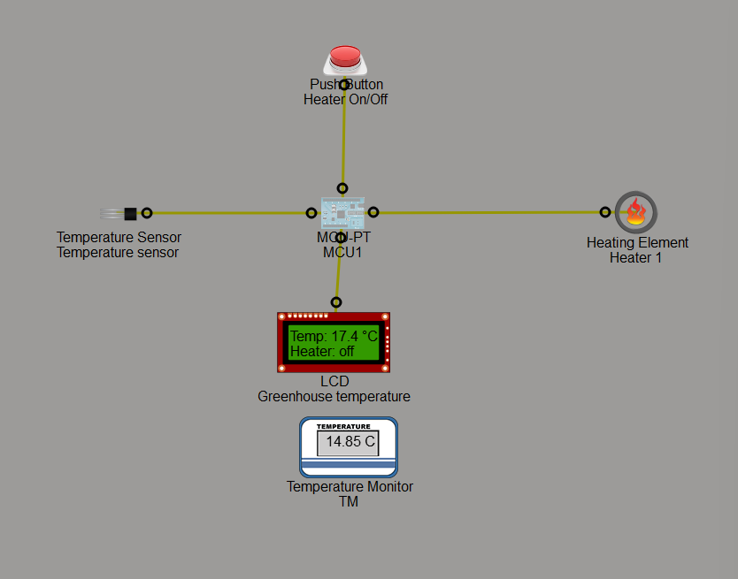
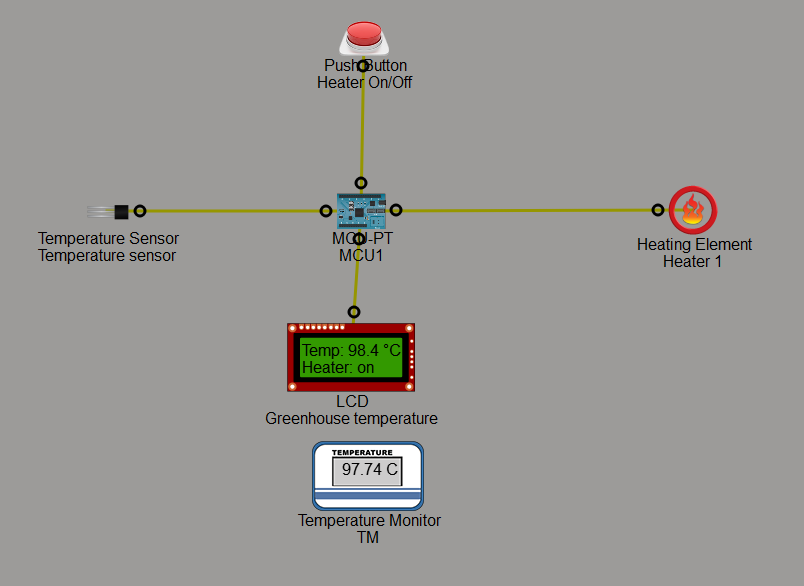

# Smart Heater Automation 
This project is a simple smart heater automation system built using Python in Cisco Packet Tracer IoT simulation.

**The script demonstrates:**
- Heater ON/OFF control using a button
- LCD status updates
- Temperature sensor monitoring
- Basic automation logic
- Event-driven programming with GPIO


## Features
### Heater Control
- Pressing the button toggles the heater state.
- The heater output is connected to a digital GPIO port.

### LCD Display
- Displays the current heater status:
  - `Heater: on`
  - `Heater: off`

### Temperature Monitoring
- Reads analog temperature values from a temperature sensor.
- Converts sensor values into Celsius temperature readings.

### Event Detection
- Uses `add_event_detect()` to listen for button presses.

---

## Components Used

| Component | Purpose |
|---|---|
| Button | Toggle heater state |
| Heater Element | Simulated heating device |
| LCD Display | Displays heater status |
| Temperature Sensor | Reads room temperature |

---

## Port Configuration

| Device | Port |
|---|---|
| Heater Button | `0` |
| Heater Output | `1` |
| LCD Display | `2` |
| Temperature Sensor | `A0` |

---

## Python Script

```python
# Sensor-driven heater-finite
from gpio import *
from time import *

HEATER_BUTTON_PORT = 0
HEATER_PORT = 1 
TEMP_LCD_PORT = 2
TEMP_SENSOR_PORT = A0

TEMP_THRESHOLD = 5

# Starting/default values
heater_state = "off"
clicked_button = False


def get_temperature():
    """ Retrieve & return temperature values """
    
    raw_temp_value = ((float(analogRead(TEMP_SENSOR_PORT)) / 1024) * 201) - 100
    return raw_temp_value  #'Temp:{val:.1f}'.format(val=raw_temp_value)
 
	
def lcd_display():
	""" Display heater state and current environment temperature as strings """

	lcd_text = 'Temp: {temperature:.1f} {char}C\nHeater: {state}'.format(temperature = get_temperature(),char = chr(176),state = heater_state)
	customWrite(TEMP_LCD_PORT,lcd_text)


def button_event():
	""" Alters button's functionality after a click is detected """
	
	global clicked_button
	button_val = digitalRead(HEATER_BUTTON_PORT)
	
	# Button event detected, alter button's functionality
	if button_val == HIGH:
		clicked_button = not clicked_button


def activate_heater():
	""" Turns ON heater element, triggerred by button event or temperature sensor """

	digitalWrite(HEATER_PORT,HIGH)
	delay(500)


def main():
	""" Turns on/off heater according to currently assigned button functionality or temperature sensor signal"""
	
	while True:
		global heater_state
		if clicked_button == True or get_temperature()<= TEMP_THRESHOLD:
			heater_state = "on"
			activate_heater()
		else: # Siwtch OFF the heater
			heater_state = "off"
			digitalWrite(HEATER_PORT,LOW)
		lcd_display()
			

if __name__ == "__main__":
	#get_temperature()      ---> Uncommenting this makes the Temp value static in the lcd 
	print('Starting ...') 
	add_event_detect(HEATER_BUTTON_PORT, button_event) 
	main()
	
```

## How It Works
The system starts with the heater turned OFF.

**The LCD displays:**
- Heater: `OFF`

**When the button is pressed:**
- The heater turns `ON`

**LCD updates to:**
- Heater: `ON`
- Current temperature is printed to the console
- Pressing the button again toggles the heater `OFF`.

## Temperature Formula
The temperature conversion formula used:
```python
temperature_value = ((float(analogRead(TEMP_SENSOR_PORT)) / 1024) * 201) - 100
```
This converts analog sensor readings into temperature values in Celsius.


## Packet Tracer Workspace Snapshot
Below is the topology workspace used in Packet Tracer.

> **Initial State**


> **Heater Off State**


> **Heater On State**


## Demo
Below is the project demo of the temperature sensor and heating system using push button.
<video src="../media/lab-3.1.2-demo.mp4" controls></video>
