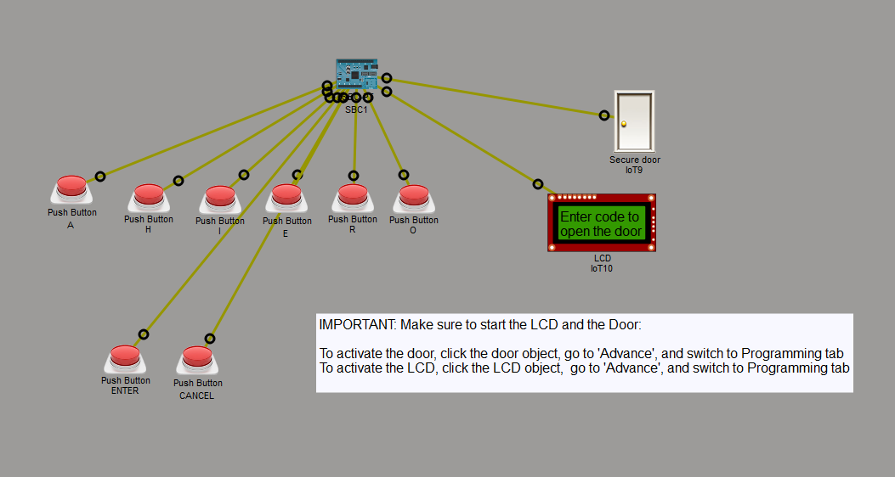
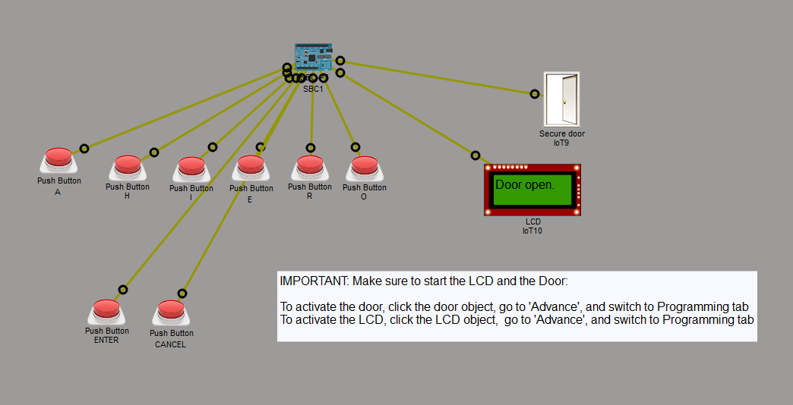
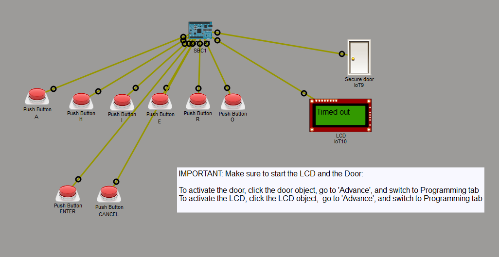

# Secure Door Automation
This project is a secure door automation system built using Python in the Cisco Packet Tracer IoT simulation environment.
The simulation demonstrates how multiple IoT devices communicate together to create a basic access-control system with real-time user interaction.

The system allows a user to enter a password using physical push buttons.
If the entered code is correct, the simulated door unlocks temporarily before automatically closing again.

## Project Overview

The simulation is divided into three main components:
- SBC Controller (Main Logic)
- Automated Door Controller
- LCD Display Module

These components communicate using GPIO ports and custom Packet Tracer device messaging.

## System Workflow
1. The LCD displays a prompt asking the user to enter a security code.
2. The user presses character buttons to build a password.
3. A countdown timer starts once input begins.
4. The entered code is validated when the Enter button is pressed.
5. If the code is correct:
	- The door opens.
	- The LCD displays a success message.
	- The door automatically closes after a short delay.
6. If the code is incorrect or time expires:
	- The LCD displays an error or timeout message.
	- The system resets to its default state.
7. The `Cancel` button clears the current input and resets the session.

## Features
### Secure Password Entry
Users enter a predefined access code using hardware buttons.

The correct code for this simulation is:
`IROH`

### Real-Time LCD Feedback
The LCD provides live system updates, including:

Default instructions
- Countdown timer
- Door status
- Invalid code warnings
- Timeout notifications

### Automatic Door Control
- The door opens only after successful authentication.
- The door closes automatically after a short delay.

### Event-Driven Input Handling
- Uses `add_event_detect()` to listen for button presses.
- Simulates interrupt-based embedded system behaviour.

### Timeout Protection
- A 10-second countdown prevents unfinished sessions from remaining active.
- If the timer expires, the system resets automatically.

### Cancel & Reset Functionality
- Users can clear the current input at any time using the cancel button.


## Port Configuration
### SBC Controller
| Device        | Port |
| ------------- | ---- |
| LCD Display   | `0`  |
| Button A      | `1`  |
| Button I      | `2`  |
| Button E      | `3`  |
| Button H      | `4`  |
| Button R      | `5`  |
| Button O      | `6`  |
| Enter Button  | `7`  |
| Cancel Button | `8`  |
| Secure Door   | `9`  |

### Door Controller
| Device                     | Port |
| -------------------------- | ---- |
| External Instruction Input | `0`  |
| Door Internal Control      | `1`  |

## Core Logic
### Authentication System
The SBC continuously listens for button events and builds a string representing the entered password.

Example:
```
code_input += "I"
```

The entered value is then compared against the predefined secure code:

```
correct_code = 'IROH'
```

### Door Communication
When authentication succeeds, the SBC sends a custom instruction to the door controller:
```
customWrite(SECURE_DOOR_PORT,'Open')
```

The door controller receives this instruction and activates the internal door pin.

### LCD Messaging
The LCD module dynamically updates messages such as:
```
Enter code to
open the door
```

```
Entering code
8 secs left
```
```
Door open.
```
```
Incorrect code
entered
```

## Packet Tracer Simulation Behaviour
### Initial State
- Door is closed
- LCD shows the default instruction message

### Successful Authentication
- Correct password entered
- Door opens temporarily
- LCD displays Door open.

### Incorrect Authentication
- Wrong password entered
- LCD displays Incorrect code entered
- Door remains closed

### Timeout State
- No valid input completed within 10 seconds
- LCD displays Timed out
- System resets automatically

---

## Python Script of SBC1

```python
from gpio import *
from time import *

# Objects
SECURE_DOOR_PORT = 9
LCD_PORT = 0

# Buttons
BUTTON_PORT_A = 1
BUTTON_PORT_I = 2
BUTTON_PORT_E = 3
BUTTON_PORT_H = 4
BUTTON_PORT_R = 5
BUTTON_PORT_O = 6

ENTER_BUTTON_PORT = 7
CANCEL_BUTTON_PORT = 8


# Code
correct_code = 'IROH'
code_input = ''

DEFAULT_TEXT = 'Enter code to\nopen the door'
customWrite(LCD_PORT , DEFAULT_TEXT)

# Time
timer_count = 10
countdown_running = False
door_reset = False


def button_detectors():
	""" Adding to the code_input string value according to the button pressed"""

	global code_input,countdown_running
	countdown_running = True
	
	if digitalRead(BUTTON_PORT_A) == HIGH:
		code_input += "A"
		
	elif digitalRead(BUTTON_PORT_I) == HIGH:
		code_input += "I"
		
	elif digitalRead(BUTTON_PORT_E) == HIGH:
		code_input += "E"
	
	elif digitalRead(BUTTON_PORT_H) == HIGH:
		code_input += "H"
	
	elif digitalRead(BUTTON_PORT_R) == HIGH:
		code_input += "R"
	
	elif digitalRead(BUTTON_PORT_O) == HIGH:
		code_input += "O"
		

def reset_state():
	""" Resetting countdown and code_input value to empty """
	
	global code_input,countdown_running
	code_input = ''
	
	countdown_running = False
	
def enter_button_event():
	""" Code is confirmed, informs user about the validated code input. If correct, opens the door for a certain time.   """
	
	if digitalRead(ENTER_BUTTON_PORT) == HIGH:
		if code_input == correct_code:
			customWrite(SECURE_DOOR_PORT,'Open')
			global door_reset 
			
			customWrite(LCD_PORT,'Door open.')
			door_reset = True
			reset_state()
			
		elif code_input ==  '':
			customWrite(LCD_PORT,'No code\nentered')
			reset_state()
		
		elif code_input !=  correct_code:
			customWrite(LCD_PORT,'Incorrect code\nentered')
			reset_state()
			

def cancel_button_event():
	""" Clearing all inhput and calling function to return to the starting state """
	if digitalRead(CANCEL_BUTTON_PORT) == HIGH:
		customWrite(LCD_PORT,'Cancelling')
		reset_state()


def entering_code_display():
	""" Displaying timer when user starts to input the pin code"""
	
	lcd_text = 'Entering code\n{} secs left'.format(timer_count)
	customWrite(LCD_PORT,lcd_text)
	
	if timer_count  == 0:
		lcd_text = 'Timed out'
		customWrite(LCD_PORT,lcd_text)
		reset_state()
	
def main():
	""" During countdown, calls display function and reduce timer count. Otherwise, closes the door and display the starting text and reset timer."""
	
	print('Starting ...') 
	global timer_count
	while True:
		if countdown_running == True:
			print(code_input)
			entering_code_display()
			sleep(0.9)
			timer_count -= 1

		else:
			if door_reset == True:
				sleep(1)
				customWrite(LCD_PORT,'Door Close.')
				customWrite(SECURE_DOOR_PORT,'Close')
				print('done')
				
			sleep(1)
			customWrite(SECURE_DOOR_PORT,'Close')
			timer_count = 10
			customWrite(LCD_PORT,DEFAULT_TEXT)
			
			
			
		
if __name__ == "__main__":
	BUTTON_PORTS_LIST = [BUTTON_PORT_A,BUTTON_PORT_I,BUTTON_PORT_E,BUTTON_PORT_H,BUTTON_PORT_R,BUTTON_PORT_O]
	
	for port in BUTTON_PORTS_LIST:
		add_event_detect(port, button_detectors)
	
		
	add_event_detect(ENTER_BUTTON_PORT, enter_button_event)
	add_event_detect(CANCEL_BUTTON_PORT, cancel_button_event)
		
	main()

```

## Packet Tracer Workspace Snapshot
Below is the topology workspace used in Packet Tracer.

> **Initial State**


> **Successful Pin Code: Door Open State**


> **Timed out: Door Unopened State**


## Demo
Below is the project demo of the temperature sensor and heating system using push button.
<video src="../media/lab-4.1.2-demo.mp4" controls></video>


## Future Improvements
- Input display
- Backspace (single-click)
- Clear (double-click)
- Door is closing warning display
- Code refactored